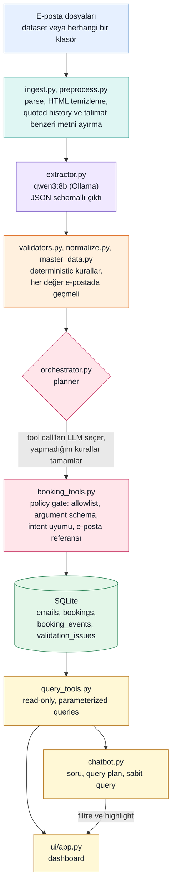
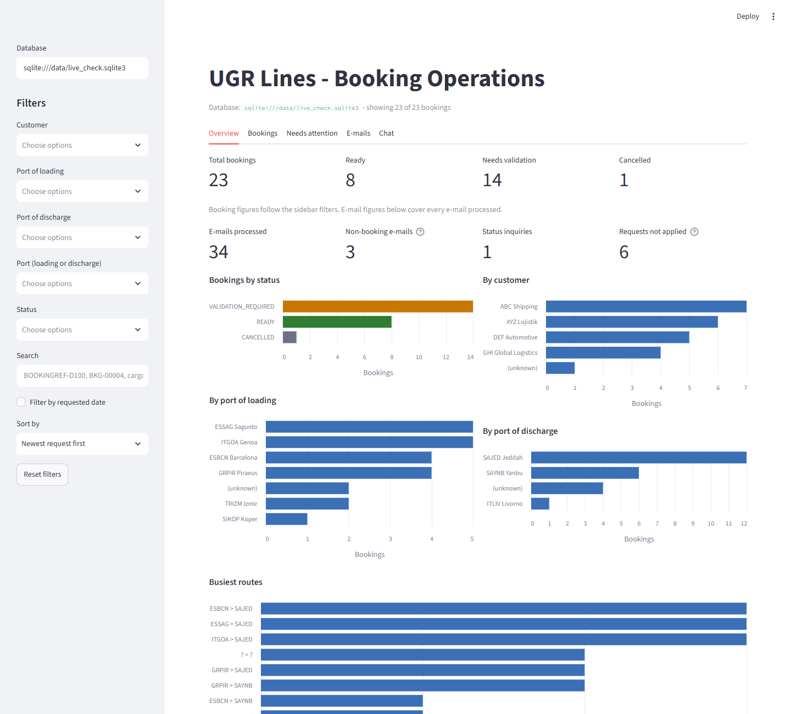
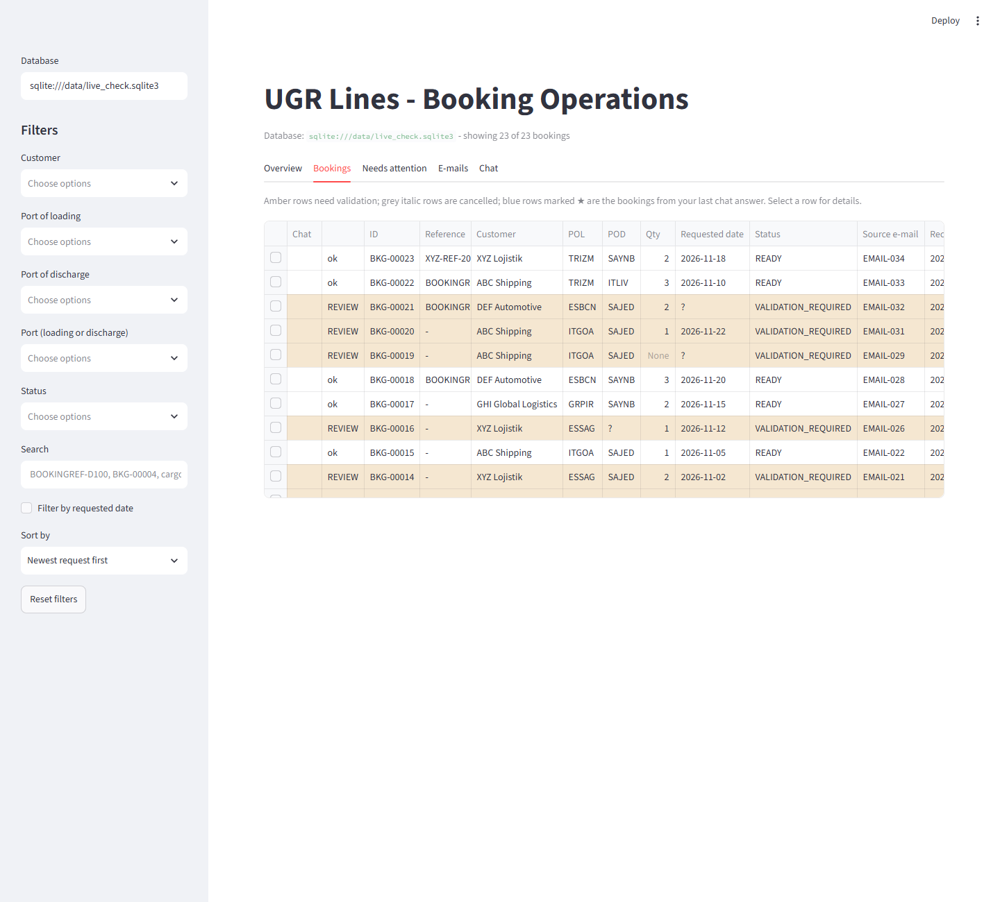
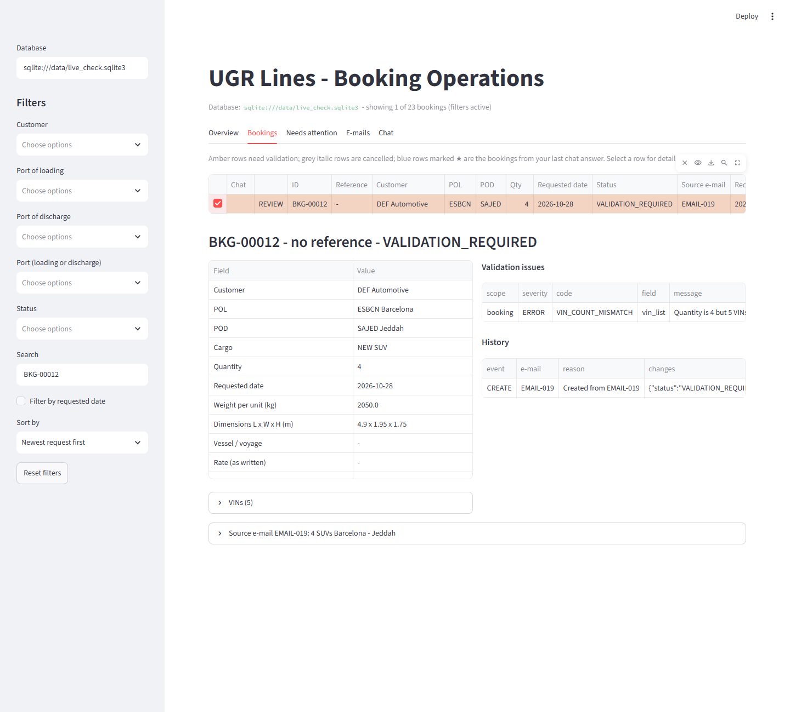
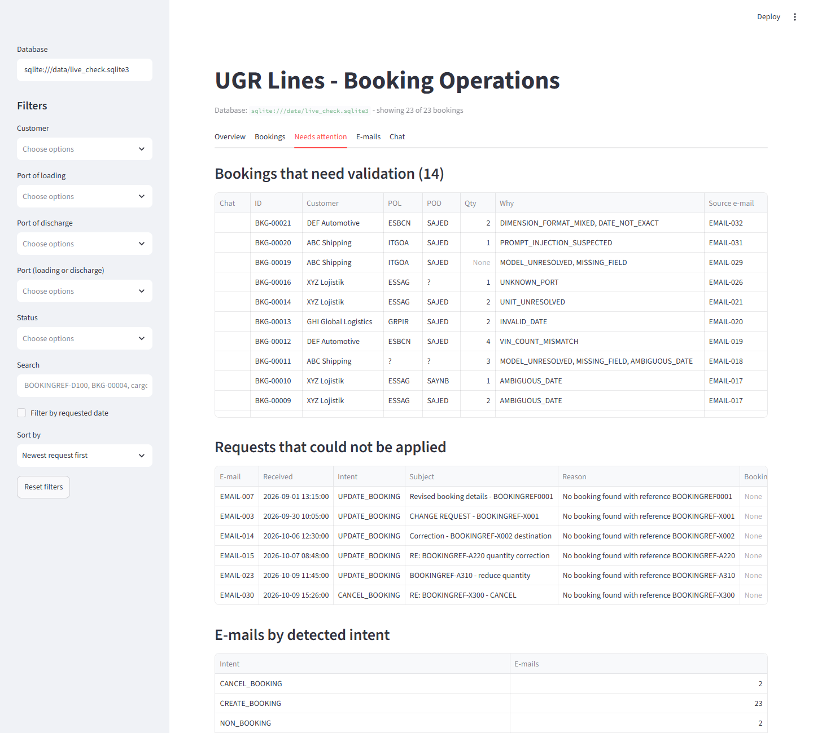
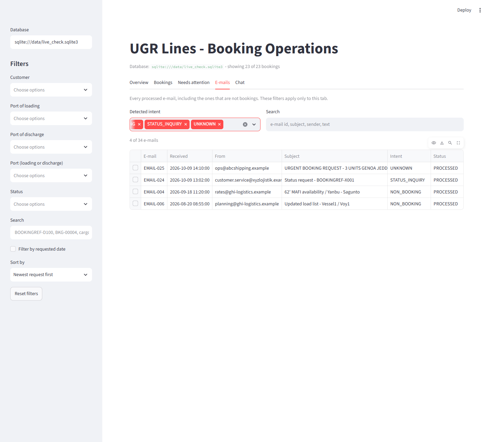
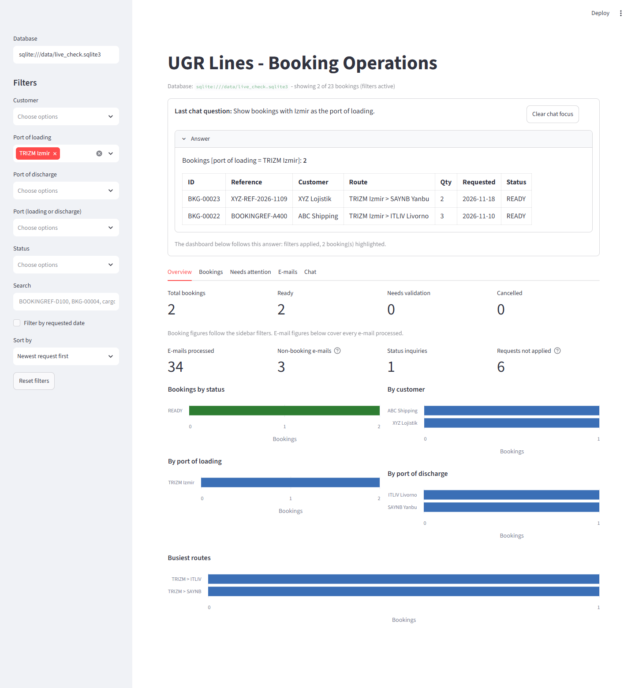

# UGR AI Booking Intake & Operations Assistant

Booking e-postalarını validated booking kayıtlarına çeviren, bunları interactive bir dashboard'da gösteren ve kayıtlar
hakkında doğal dilde soru sorulmasını sağlayan küçük ama çalışan bir prototip.

```text
E-posta  ->  preprocessing  ->  LLM extraction  ->  validation  ->  controlled tools  ->  SQLite  ->  dashboard + chatbot
```

LLM **okur** (öneri üretir), kod **kontrol eder ve karar verir**, yazma işini ise yalnızca policy check'ten geçen az sayıda
tool yapar. Sistemin emin olmadığı hiçbir şey tahmin edilmez, review için işaretlenir.

| | |
|---|---|
| Dil / stack | Python 3.12, Pydantic, SQLAlchemy + SQLite, Streamlit |
| LLM | [Ollama](https://ollama.com) üzerinden local `qwen3:8b` (API key yok, cloud yok) |
| Girdi | Verilen 34 e-posta (Git dışında tutulur) ve `.txt` e-postalardan oluşan herhangi bir klasör |
| Durum | Core flow tamam ve test edildi; bkz. [sonuçlar](#sağlanan-e-postalardaki-sonuçlar) ve [bilinen sınırlamalar](#bilinen-sınırlamalar) |

## Hızlı başlangıç (Windows PowerShell)

1. **Python 3.11 veya 3.12** kur (paket diğer sürümleri reddeder) ve [Ollama](https://ollama.com)'yı kur, sonra modeli indir
   (yaklaşık 5 GB, 8 GB VRAM'li bir GPU'da çalışır):

   ```powershell
   ollama pull qwen3:8b
   ```

2. Repo klasöründe virtual environment oluştur:

   ```powershell
   python -m venv .venv
   .\.venv\Scripts\python.exe -m pip install -r requirements.txt
   .\.venv\Scripts\python.exe -m pip install -e .
   ```

3. Dataset'i şuraya koy (repo'da **yoktur**, bkz. [özel veri](#yapılandırma-ve-özel-veri)):

   ```text
   data/private/dataset/      (manifest.json, emails/, master_data/; ZIP de olur)
   ```

4. E-postaları ingest et (8 GB VRAM'li GPU'da LLM ile 5 ila 10 dakika), sonra dashboard'u aç:

   ```powershell
   .\.venv\Scripts\python.exe -m ugr_booking.cli ingest
   .\.venv\Scripts\python.exe -m streamlit run ui/app.py
   ```

   Dashboard `http://localhost:8501` adresinde açılır. `ingest` komutunu tekrar çalıştırmak hiçbir şey eklemez (idempotent):
   işlenmiş e-postalar atlanır.

5. Testleri çalıştır (LLM gerekmez, yaklaşık 10 saniye):

   ```powershell
   .\.venv\Scripts\python.exe -m pytest -q
   ```

macOS/Linux: `python3` ve `.venv/bin/python` ile aynı komutların çalışması beklenir; yalnızca Windows'ta denendi.

**GPU veya Ollama yok mu?** Üç seçenek var:

- **Testler LLM gerektirmez** (`pytest -q`). Dataset yoksa dataset'e bağlı testler atlanır, geri kalanı çalışır.
- **Replay:** LLM çıktısı `record-extractions` ile bir kez kaydedilir ve `ingest --extractions <klasör>` ile LLM olmadan
  tekrar işlenir (live AI olmadığı açıkça yazılır). Chatbot'u keyword interpreter ile kullan:

  ```powershell
  .\.venv\Scripts\python.exe -m ugr_booking.cli ingest --extractions data/private/extractions
  $env:UGR_CHAT_PLANNER = "keywords"
  ```

  Dataset'in gerçek e-postalarından gelen kayıt gizli veri sayılır ve repoda **yoktur**; GPU'su olmayan biri bu kaydı
  yazardan isteyebilir ya da modeli CPU üzerinde çalıştırabilir (denenmedi, çok yavaş olması beklenir).
- **Follow-up demo'su:** `examples/demo_recording` yalnızca uydurma `examples/demo_inbox` e-postalarının kaydıdır. Ana
  booking'ler olmadan bu altı e-posta `BOOKING_NOT_FOUND` ile review'a düşer; bu beklenen davranıştır.

Sabit demo akışı (`scripts/demo.ps1`, [docs/demo_akisi.md](docs/demo_akisi.md)) model olmadan da çalışan `followup-offline`
ve `dashboard -Offline` adımlarını içerir, ama ana veritabanını hazırlamak için önce bir ingest gerekir.

## Mimari



### AI nerede, nerede değil

| Adım | LLM | Deterministic kod |
|---|---|---|
| E-postayı okuma | Intent ve alanlar, yazıldığı gibi kopyalanır (`extractor.py`) | Temizleme, quoted history ve injection handling (`preprocess.py`) |
| Sonucu kontrol etme | hiçbir şey | Master data match, birimler, tarihler, VIN ve quantity kuralları, "değer e-postada geçmeli" (`validators.py`) |
| Aksiyon alma | Hangi tool'un çağrılacağını seçer (`GuardedLLMPlanner`) | Allowlist, argument ve intent kontrolleri, atlananı tamamlayan kurallar, **tüm write işlemleri** (`booking_tools.py`) |
| Soru cevaplama | Soruyu küçük bir query plan'a çevirir (`chatbot.py`) | Plan'ı soruya ve master data'ya karşı validate eder, sabit read-only query'leri çalıştırır, **cevap metnini yazar** |

LLM hiçbir zaman SQL yazmaz, cevap yazmaz, veritabanına yazmaz ve bir booking'in valid olduğuna karar vermez.

### Modüller

| Dosya | Sorumluluk |
|---|---|
| `dataset.py`, `master_data.py` | Dataset'i güvenli okuma; alias matching'li müşteri ve liman master data'sı |
| `ingest.py`, `preprocess.py` | E-posta parsing; tek bozuk dosya batch'i asla durdurmaz |
| `extractor.py`, `recorded.py` | LLM çağrısı, prompt, schema, retry; LLM çıktısını record ve replay etme |
| `normalize.py`, `validators.py` | Sayı, ağırlık, ölçü ve tarih parsing; business rules ve issue code'ları |
| `db.py`, `repository.py` | Dört tablo ve tüm read/write işlemleri |
| `booking_tools.py`, `orchestrator.py` | Tool'lar ve policy gate; e-posta başına bir transaction; planner'lar |
| `query_tools.py`, `chatbot.py`, `ui/app.py` | Ortak read-only query'ler; doğal dil cevapları; Streamlit dashboard |
| `cli.py` | Komutlar |

### Data model

İlk çalıştırmada oluşturulan ve çalıştırmalar arasında korunan dört SQLite tablosu:

| Tablo | İçerik |
|---|---|
| `emails` | Orijinal ve temizlenmiş metin, intent, status, outcome, error, LLM'in ham çıktısı |
| `bookings` | Güvenilir alanlar, `status`, VIN listesi, ölçüler, LLM'in yazdığı haliyle değerler (`raw`), source e-posta |
| `booking_events` | `CREATE`, `UPDATE`, `CANCEL`, `DUPLICATE`, `FAILED_ACTION`; her biri source e-postasını taşır |
| `validation_issues` | Code, field, severity, message, review status (booking veya e-posta seviyesinde) |

Mesaj intent'leri: `CREATE_BOOKING`, `UPDATE_BOOKING`, `CANCEL_BOOKING`, `STATUS_INQUIRY`, `NON_BOOKING`, `UNKNOWN`.
Booking status'ları: `READY` (validation'dan geçti), `VALIDATION_REQUIRED` (bir insanın bakması gerekir), `CANCELLED`.
`ASSIGNED` schema'da vardır ama hiçbir zaman set edilmez: hiçbir sailing ataması yapılmaz.

## Güvensiz veya belirsiz girdi nasıl ele alınıyor

- **Kaynak kanıtı aranır.** Eksik değerler boş kalır; modelin yazdığı alanlar doğrudan kabul edilmez. Müşteri için metin/gönderen içindeki master-data alias'ı, adet için açık bir birim adedi ve diğer alanlar için kaynak metin kontrol edilir. Ağırlık ve ölçülerin birimi kaynaktaki ifadeyle karşılaştırılır. Desteklenmeyen değerler `VALUE_NOT_IN_SOURCE` ile incelemeye bırakılır.
- **Belirsizlik görünür kalır.** POL/POD satırındaki alternatifler model tek liman seçse de kontrol edilir; kritik `unresolved_fields` bildirimi review gerektirir. `JEDDAH / YANBU`, `SEPTEMBER SAILING`, `next available after 25/11/2026`,
  birimsiz bir ağırlık ve `6,20 x 2.450 x 3,10 m` unresolved kalır ve booking validation bekler.
- **Invalid değerler düzeltilmez** (`31/02/2026` invalid kalır).
- **E-posta metni untrusted'dır.** Quoted history yalnızca bağlam olarak verilir; sisteme hitap eden paragraflar
  (`SYSTEM NOTE`, `ignore ... rules`, `invent ... values`) LLM'den saklanır ve e-postayı review için işaretler.
  Backend prompt'un güvenliğine yaslanmaz: master data ve "e-postada geçmeli" kontrolü LLM kandırılsa bile geçerlidir.
- **UPDATE ve CANCEL asla booking oluşturmaz.** Bilinen bir booking yoksa talep `FAILED_ACTION` olarak kaydedilir.
  Tekrarlanan talep `DUPLICATE` olur; kayıtlı bir booking ile çelişen tekrar `CONFLICT_REQUIRES_REVIEW` olur ve hiçbir şeyin
  üzerine yazmaz; cancelled bir booking tekrar canlandırılmaz.
- **Tool'lar policy check'ten geçer.** Kapalı allowlist, strict argument schema, tool'un e-postanın intent'ine uyması,
  booking referansının e-postadaki referans olması. Argument'lar yalnızca identifier taşır; yazılan veri her zaman validated
  draft'tan gelir.
- **Chatbot read-only'dir** (write intent'i yoktur ve cevap verirken bağlantısı read-only'dir). Bilinmeyen bir müşteri
  veya liman boş cevap verir, asla "tüm booking'ler" değil.
- **Her e-posta ayrı işlenir.** Çıkarım ve validation hatası o e-postaya kaydedilir; diğer girdiler devam eder. Yazma adımı tek transaction'dır ve hata halinde rollback edilir. Sonlu olmayan sayılar kabul edilmez.

## Komutlar

```powershell
$py = ".\.venv\Scripts\python.exe"
& $py -m ugr_booking.cli inspect-dataset          # manifest ve master data kontrolleri
& $py -m ugr_booking.cli parse-emails             # tüm e-postaları oku ve temizle (LLM yok)
& $py -m ugr_booking.cli extract  EMAIL-017       # tek e-posta için LLM çıktısı, hiçbir şey kaydedilmez
& $py -m ugr_booking.cli validate EMAIL-019       # LLM + business rules, hiçbir şey kaydedilmez
& $py -m ugr_booking.cli ingest                   # tüm e-postalar data/booking.sqlite3'e (tool call'ları LLM seçer)
& $py -m ugr_booking.cli ingest --planner direct --only EMAIL-008 EMAIL-012 EMAIL-013   # LLM yerine sabit kurallar
& $py -m ugr_booking.cli ingest --inbox examples/demo_inbox --db sqlite:///data/demo.sqlite3   # follow-up'lar: update, cancel, status
& $py -m ugr_booking.cli list-bookings --events   # kayıtlı olanlar
& $py -m ugr_booking.cli report                   # Markdown: her e-postanın outcome'u, booking'leri ve event'leri
& $py -m ugr_booking.cli record-extractions       # tüm e-postalar için LLM çıktısını kaydet (data/private/extractions)
& $py -m ugr_booking.cli ingest --extractions data/private/extractions   # offline replay, live AI olmadığı etiketlenir
& $py -m streamlit run ui/app.py                  # dashboard
& $py -m pytest -q                                # testler (LLM gerekmez)
& $py -m pytest --live -q                         # gerçek LLM'i çağıran regression kontrolleri de
```

Dashboard sekmeleri: **Overview** (KPI'lar ve grafikler), **Bookings** (filtrelenebilir tablo, satır detayı, history, source
e-posta), **Needs attention** (her booking'in neden validation gerektirdiği, uygulanamayan talepler), **Chat**. Chat cevapları
dashboard'u otomatik olarak filtreler ve highlight eder. Örnek sorular: *How many bookings does ABC Shipping have?* - *Show
bookings with Izmir as the port of loading.* - *Which bookings require validation?* - *Summarize the latest three bookings.* -
*What is the status of BOOKINGREF-D100?* - *Show cancelled bookings.*

Follow-up demo: `examples/demo_inbox` içinde **uydurma** altı e-posta vardır (tarih değiştir, quantity değiştir,
bilinmeyen müşteriyi reddet, status sor, cancel et, bilinmeyen referansı değiştir) ve kayıtlı booking'lere karşı çalışır. LLM
çıktıları `examples/demo_recording` içinde kayıtlıdır, bu yüzden demo offline da çalışır (replay olduğu açıkça yazılır).

Demo: [docs/demo_akisi.md](docs/demo_akisi.md) sabit demo akışıdır, `scripts/demo.ps1` bunu hazırlar ve resetler
(`preflight`, `prepare`, `reset`, `dashboard`, `followup`, `followup-offline`, `status`).

Daha fazla ayrıntı: [extraction](docs/step_2.md), [validation](docs/step_3.md), [persistence ve tool'lar](docs/step_4.md),
[dashboard](docs/step_5.md), [chatbot](docs/step_6.md), [test ve batch run kaydı](docs/run_record.md),
[setup kararları](docs/decisions.md).

## Yapılandırma ve özel veri

`.env.example` yalnızca isimleri listeler: `DATASET_PATH` (default `data/private/dataset`), `DATABASE_URL`
(default `sqlite:///data/booking.sqlite3`), `OLLAMA_URL` ve `OLLAMA_MODEL`. Hiçbir yerde API key gerekmez.

Dataset gizli veridir. Dataset, veritabanları, kaydedilmiş LLM çıktıları ve log'lar `data/` altında durur ve Git dışında
tutulur; bir test hiçbir secret, veritabanı ya da dataset içeriğinin track edilmediğini kontrol eder. Testler uydurma veri kullanır.

## Tanımlar

- **Latest** booking = request e-postası en geç gelen booking (processing zamanı değil).
- **Cancelled** booking'ler toplamlara dahildir ve chatbot bunu söyler.
- **Needs validation** = status `VALIDATION_REQUIRED`. Booking olmayan e-postalar asla booking olarak sayılmaz.

## Varsayımlar

- Sayısal tarihler **gün-ay-yıl** okunur (veride yalnızca bu şekilde anlamlı olan `22/11` ve `28/10` var); iki haneli yıl 20xx demektir.
- Ağırlıklar **yalnızca kilogramdır**. `7.650`, `12,400`, `7 450` binlik ayraçtır; `12.500,50` ondalık virgüllüdür. Birden çok
  araç için "each" olmayan ağırlık araç başına saklanmaz. Ölçüler length x width x height'tır ve metreye çevrilir.
- Bir booking yalnızca customer, iki liman, cargo, quantity ve gerçek bir requested date varsa, master data ile eşleşiyorsa ve
  error üretmiyorsa `READY` olur. Contact, vessel ve voyage optional'dır. Hiçbir şey `ASSIGNED` olmaz.
- Müşteriler ve limanlar isimler, alias'lar ve liman kodlarıyla **exact** match olur (capitalisation ve aksan fark etmez).
  Fuzzy matching yoktur.
- Aynı referansa ya da birebir aynı, boş olmayan VIN kümesine sahip tekrar, aynı booking sayılır.
- Verilen VIN'ler sentetiktir: yalnızca bir booking içinde sayı, tekrar ve tutarlı format kontrol edilir, gerçek VIN standardı değil.
- Quoted history bağlamdır, asla instruction değildir. Attachment'lar okunmaz. Time zone varsayılmaz.
- Tek kullanıcı, local SQLite.

## Sağlanan e-postalardaki sonuçlar

RTX 4060 üzerinde `qwen3:8b` ile ölçüldü (ayrıntılar [docs/run_record.md](docs/run_record.md) içinde):

- 34 e-postanın 34'ü işlendi, 0 failure; 23 booking draft'ı: 9 `READY`, 14 `VALIDATION_REQUIRED`; 1 duplicate, 1 cancellation.
- 6 follow-up e-postası uygulanamadı, çünkü orijinal booking'leri dataset'te yok; kaydedildiler, hiçbir şey uydurulmadı.
- LLM 49 tool call seçti, sabit kuralların tamamlaması gereken hiçbir şey olmadı ve policy gate LLM'in 15 gereksiz çağrısını reddetti.
- LLM çıktısının iki bağımsız recording'i aynıydı; temiz bir clone'da sonraki bir live run optional ve engellemeyen tek bir alanda
  (bir e-postada voyage warning'i) farklıydı. `ingest` komutunu tekrar çalıştırmak hiçbir şey eklemez.
- Süre: LLM extraction'ı e-posta başına yaklaşık 7,5 saniye sürer (34'ü için 256 saniye); LLM'in tool seçtiği tam bir `ingest`
  tekrarlanan çalıştırmalarda 6 ila 9 dakika sürdü; API maliyeti yok.
- Son düzeltmelerle LLM çağırmadan **337 test geçti, 22 canlı model testi atlandı**. `--live` ile bu 22 test de geçti.
  Düzeltmelerden sonra 34 e-postanın tamamı canlı modelle yeniden işlendi: her e-postanın intent ve status'ü aynı kaldı
  (23 booking, 8 `READY`, 14 `VALIDATION_REQUIRED`, 1 `CANCELLED`); tek fark `EMAIL-001`'in adedi: e-posta adedi yazmadığı
  için artık boş kalıyor.

## Test

Unit test'ler parsing, normalization, validation, tool policy, persistence, chatbot ve dashboard'u (headless çalıştırılır)
kapsar. Kapsanan failure path'ler: bozuk girdi, kapalı LLM, bir e-postanın ortasında rollback ve yanlış tool ya da hiç tool
seçen LLM. `tests/test_scenarios.py` verilen 34 e-postanın tamamını kaydedilmiş bir LLM çıktısı üzerinde tüm pipeline'dan
geçirir ve her biri için beklenen sonucu kontrol eder; `tests/test_live.py --live` temel sonuçları gerçek LLM ile yeniden
kontrol eder. Scenario test'leri local dataset'i ve recording'i gerektirir, bu yüzden bunlar olmayan bir makinede skip edilir.
Scenario beklentileri e-postalar okunarak çıkarılmış hipotezlerdir, resmî bir cevap anahtarı değildir.

## Bilinen sınırlamalar

- **UPDATE value extraction karmaşık mesajlarda güvenilir değildir** (örneğin kaldırılan bill of lading'leri listeleyen revize
  bir booking). Backend kontrolleri bazı durumları yakalar (quantity ile VIN sayısı; invalid değerler uygulanmaz), ama production'da
  update'ler için human approval gerekir.
- **Temperature 0, LLM'i bit düzeyinde repeatable yapmaz.** İki live run'da optional bir alan farklı çıktı; bu yüzden
  regression test'leri LLM'i çağırmak yerine kaydedilmiş bir LLM çıktısını replay eder.
- **LLM prompt'a duyarlıdır.** Geliştirme sırasında küçük ifade değişiklikleri belirsiz e-postaların intent'ini çevirdi; prompt artık
  örnek kullanıyor ve scenario ile live test'ler onu koruyor. Prompt'u ya da modeli değiştirdikten sonra recording'i yenile ve
  `--live` test'lerini yeniden çalıştır.
- Verilen follow-up'lar dataset'te olmayan booking'lere işaret eder; bu yüzden update path'i gerçek veride yalnızca uydurma
  demo e-postalarıyla gösterildi.
- Duplicate detection bir referans ya da birebir aynı VIN'ler ister. Injection filter'ı sınırlı bir pattern listesidir; "değer
  e-postada geçmeli" kontrolü ikinci savunma hattıdır.
- Attachment'lar okunmaz ("ekteki Excel'de" detayı olan bir booking `VALIDATION_REQUIRED` kalır).
- Review görünürdür ama bir issue'yu approve edecek ya da resolve edecek bir ekran yoktur; issue'lar `OPEN` kalır.
- Structured logging ve container yok. SQLite tek kullanıcılıdır; dashboard read-only'dir.
- Yalnızca 34 sentetik e-posta vardı, bu yüzden genel bir accuracy iddiası yoktur.

## Sonra ne yapardım

1. **Human review screen:** issue'ları resolve et, update'leri uygulanmadan önce approve ya da reject et, audit trail ile.
2. Daha büyük, labeled bir evaluation set, alan başına confidence score ve modellerin karşılaştırılması.
3. Attachment parsing (Excel/PDF), mailbox integration ve batch komut yerine bir queue.
4. Authentication ve roller, PostgreSQL, structured logging ve monitoring, bir container image.

## Proje yapısı

```text
src/ugr_booking/   Uygulama paketi
ui/                Streamlit dashboard (ui/app.py)
examples/          Update/cancel demosu için uydurma follow-up e-postaları
tests/             Unit, end-to-end, scenario, live ve repo hijyen testleri
docs/              Adım notları, run kaydı, setup kararları
data/private/      Dataset ve local recording'ler (Git dışında)
```

## Ekran görüntüleri

Aşağıdaki görüntüler, verilen 34 sentetik e-postanın `qwen3:8b` ile canlı işlenmesinden oluşan veritabanından alındı
(23 booking: 8 `READY`, 14 `VALIDATION_REQUIRED`, 1 `CANCELLED`). Ham e-posta metni gösterilmez.

### Overview

KPI'lar (toplam, hazır, validation bekleyen, iptal edilen), e-posta bazlı sayılar (booking olmayan e-postalar, status
sorguları, uygulanamayan talepler) ve status, müşteri, POL, POD ve rota kırılımları. Sol taraftaki filtreler booking
rakamlarını ve grafikleri değiştirir.



### Bookings

Filtrelenebilir booking tablosu: amber satırlar validation bekler, gri italik satırlar iptal edilmiştir. Bir satır
seçilince detay, validation issue'ları ve history açılır.



### Booking detayı

`BKG-00012` örneği: e-postada 4 adet yazıyor ama 5 VIN listelenmiş. Sistem bunu düzeltmeye çalışmaz; `VIN_COUNT_MISMATCH`
issue'su açar ve booking `VALIDATION_REQUIRED` olarak kalır. Kaynak e-posta ve VIN listesi açılır panellerdedir.



### Needs attention

Her booking'in neden validation gerektirdiği (`UNKNOWN_PORT`, `INVALID_DATE`, `AMBIGUOUS_DATE`, `PROMPT_INJECTION_SUSPECTED`
gibi kodlarla) ve uygulanamayan talepler (kayıtlı olmayan bir booking'e gelen update ve cancel e-postaları).



### E-mails

İşlenen her e-posta, booking olmayanlar dahil. Detected intent filtresi ve arama vardır; örnekte `NON_BOOKING`,
`STATUS_INQUIRY` ve `UNKNOWN` e-postaları listelenir.



### Chat

Salt okunur chatbot. Cevap yalnızca veritabanındaki satırlardan üretilir ve dashboard'u da filtreler ve highlight eder:
örnekte "Show bookings with Izmir as the port of loading." sorusu cevabı gösterir ve Port of loading filtresini uygular.


