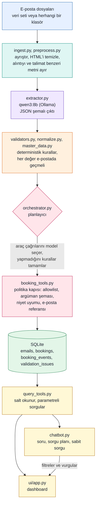

# UGR AI Booking Intake & Operations Assistant

Booking e-postalarını doğrulanmış booking kayıtlarına çeviren, bunları etkileşimli bir dashboard'da gösteren ve kayıtlar
hakkında doğal dilde soru sorulmasını sağlayan küçük ama çalışan bir prototip.

```text
E-posta  ->  ön işleme  ->  LLM ile çıkarım  ->  doğrulama  ->  kontrollü araçlar  ->  SQLite  ->  dashboard + chatbot
```

Model **okur** (öneri üretir), kod **denetler ve karar verir**, yazmayı ise yalnızca politika denetiminden geçen az sayıda
araç yapar. Sistemin emin olmadığı her şey tahmin edilmez, incelemeye işaretlenir.

| | |
|---|---|
| Dil / teknoloji | Python 3.12, Pydantic, SQLAlchemy + SQLite, Streamlit |
| LLM | [Ollama](https://ollama.com) üzerinden yerel `qwen3:8b` (API anahtarı yok, bulut yok) |
| Girdi | Verilen 34 e-posta (Git dışında tutulur) ve `.txt` e-postalardan oluşan herhangi bir klasör |
| Durum | Çekirdek akış tamam ve test edildi; bkz. [sonuçlar](#sağlanan-e-postalardaki-sonuçlar) ve [bilinen sınırlamalar](#bilinen-sınırlamalar) |

## Hızlı başlangıç (Windows PowerShell)

1. **Python 3.11 veya 3.12** kur (paket başka sürümleri reddeder) ve [Ollama](https://ollama.com)'yı kur, sonra modeli indir
   (yaklaşık 5 GB, 8 GB'lık bir ekran kartında çalışır):

   ```powershell
   ollama pull qwen3:8b
   ```

2. Depo klasöründe ortamı oluştur:

   ```powershell
   python -m venv .venv
   .\.venv\Scripts\python.exe -m pip install -r requirements.txt
   .\.venv\Scripts\python.exe -m pip install -e .
   ```

3. Veri setini şuraya koy (depoda **yoktur**, bkz. [özel veri](#yapılandırma-ve-özel-veri)):

   ```text
   data/private/dataset/      (manifest.json, emails/, master_data/; ZIP de olur)
   ```

4. E-postaları işle (8 GB'lık ekran kartında modelle 5 ila 10 dakika), sonra dashboard'u aç:

   ```powershell
   .\.venv\Scripts\python.exe -m ugr_booking.cli ingest
   .\.venv\Scripts\python.exe -m streamlit run ui/app.py
   ```

   Dashboard `http://localhost:8501` adresinde açılır. `ingest` komutunu tekrar çalıştırmak hiçbir şey eklemez: biten e-postalar atlanır.

5. Testleri çalıştır (model gerekmez, yaklaşık 10 saniye):

   ```powershell
   .\.venv\Scripts\python.exe -m pytest -q
   ```

macOS/Linux: `python3` ve `.venv/bin/python` ile aynı komutların çalışması beklenir; yalnızca Windows'ta denendi.

**Model yok mu?** Bunun yerine kaydedilmiş bir model çıktısını tekrar oynat (canlı yapay zekâ olmadığı açıkça yazılır) ve
chat'i anahtar kelime yorumlayıcısıyla kullan:

```powershell
.\.venv\Scripts\python.exe -m ugr_booking.cli ingest --extractions data/private/extractions
$env:UGR_CHAT_PLANNER = "keywords"
```

(Kayıt, `record-extractions` ile bir kez alınır ve veri seti gibi yereldir.)

## Mimari



### Yapay zekâ nerede, nerede değil

| Adım | Dil modeli | Deterministik kod |
|---|---|---|
| E-postayı oku | Niyet ve alanlar, yazıldığı gibi kopyalanır (`extractor.py`) | Temizleme, alıntı ve enjeksiyon yönetimi (`preprocess.py`) |
| Sonucu denetle | hiçbir şey | Ana veri eşleştirme, birimler, tarihler, VIN ve adet kuralları, "değer e-postada geçmeli" (`validators.py`) |
| Harekete geç | Hangi aracın çağrılacağını seçer (`GuardedLLMPlanner`) | Allowlist, argüman ve niyet denetimleri, atlananı tamamlayan kurallar, **tüm yazmalar** (`booking_tools.py`) |
| Soruları cevapla | Soruyu küçük bir sorgu planına çevirir (`chatbot.py`) | Planı soruya ve ana veriye karşı doğrular, sabit salt okunur sorguları çalıştırır, **cevap metnini yazar** |

Model asla SQL yazmaz, asla cevap yazmaz, veritabanına yazmaz ve bir booking'in geçerli olduğuna karar vermez.

### Modüller

| Dosya | Sorumluluk |
|---|---|
| `dataset.py`, `master_data.py` | Veri setini güvenle okur; alias eşleştirmeli müşteri ve liman ana verisi |
| `ingest.py`, `preprocess.py` | E-posta ayrıştırma; tek bozuk dosya toplu işi asla durdurmaz |
| `extractor.py`, `recorded.py` | Model çağrısı, istem, şema, yeniden deneme; model çıktısını kaydet ve tekrar oynat |
| `normalize.py`, `validators.py` | Sayı, ağırlık, ölçü ve tarih ayrıştırma; iş kuralları ve sorun kodları |
| `db.py`, `repository.py` | Dört tablo ve tüm okuma/yazmalar |
| `booking_tools.py`, `orchestrator.py` | Araçlar ve politika kapısı; e-posta başına bir transaction; planlayıcılar |
| `query_tools.py`, `chatbot.py`, `ui/app.py` | Ortak salt okunur sorgular; doğal dil cevapları; Streamlit dashboard |
| `cli.py` | Komutlar |

### Veri modeli

İlk açılışta oluşturulan ve çalıştırmalar arasında korunan dört SQLite tablosu:

| Tablo | İçerik |
|---|---|
| `emails` | Özgün ve temizlenmiş metin, niyet, durum, sonuç, hata, modelin ham çıktısı |
| `bookings` | Güvenilir alanlar, `status`, VIN listesi, ölçüler, modelin yazdığı haliyle değerler (`raw`), kaynak e-posta |
| `booking_events` | `CREATE`, `UPDATE`, `CANCEL`, `DUPLICATE`, `FAILED_ACTION`; her biri kaynak e-postasını taşır |
| `validation_issues` | Kod, alan, önem, mesaj, inceleme durumu (booking veya e-posta düzeyinde) |

Mesaj niyetleri: `CREATE_BOOKING`, `UPDATE_BOOKING`, `CANCEL_BOOKING`, `STATUS_INQUIRY`, `NON_BOOKING`, `UNKNOWN`.
Booking durumu: `READY` (doğrulamadan geçti), `VALIDATION_REQUIRED` (bir insanın bakması gerekir), `CANCELLED`. `ASSIGNED`
şemada vardır ama hiçbir zaman atanmaz: hiçbir sefer ataması yapılmaz.

## Güvensiz veya belirsiz girdi nasıl ele alınıyor

- **Hiçbir şey uydurulmaz.** Eksik değerler boş kalır ve `MISSING_FIELD` olarak görünür. Modelin döndürdüğü bir değer e-posta
  metninde geçmek zorundadır; geçmiyorsa reddedilir (`VALUE_NOT_IN_SOURCE`). Bu, enjekte edilmiş değerleri de durdurur.
- **Belirsizlik çözülmez, korunur.** `JEDDAH / YANBU`, `SEPTEMBER SAILING`, `next available after 25/11/2026`,
  birimsiz bir ağırlık ve `6,20 x 2.450 x 3,10 m` çözümsüz kalır ve booking doğrulama bekler.
- **Geçersiz değerler düzeltilmez** (`31/02/2026` geçersiz kalır).
- **E-posta metni güvenilmezdir.** Alıntı geçmişi yalnızca bağlam olarak verilir; sisteme hitap eden paragraflar
  (`SYSTEM NOTE`, `ignore ... rules`, `invent ... values`) modelden saklanır ve e-postayı incelemeye işaretler.
  Backend istemin güvenliğine yaslanmaz: ana veri ve "e-postada geçmeli" denetimi model kandırılsa bile geçerlidir.
- **UPDATE ve CANCEL asla booking oluşturmaz.** Bilinen bir booking yoksa talep `FAILED_ACTION` olarak kaydedilir.
  Tekrarlanan talep `DUPLICATE` olur; kayıtlı bir booking ile çelişen tekrar `CONFLICT_REQUIRES_REVIEW` olur ve hiçbir şeyin
  üzerine yazmaz; iptal edilmiş bir booking yeniden canlandırılmaz.
- **Araçlar politika denetiminden geçer.** Kapalı allowlist, katı argüman şeması, aracın e-postanın niyetine uyması,
  booking referansının e-postadaki referans olması. Argümanlar yalnızca kimlik taşır; yazılan veri her zaman doğrulanmış
  taslaktan gelir.
- **Chatbot salt okunurdur** (yazma niyeti yoktur ve cevap verirken bağlantısı salt okunurdur). Bilinmeyen bir müşteri
  veya liman boş cevap verir, asla "tüm booking'ler" değil.
- **Her e-posta tek bir transaction'dır.** Bir hata o e-postayı geri alır, kaydedilir ve toplu iş devam eder.

## Komutlar

```powershell
$py = ".\.venv\Scripts\python.exe"
& $py -m ugr_booking.cli inspect-dataset          # manifest ve ana veri kontrolleri
& $py -m ugr_booking.cli parse-emails             # tüm e-postaları oku ve temizle (model yok)
& $py -m ugr_booking.cli extract  EMAIL-017       # tek e-posta için model çıktısı, hiçbir şey kaydedilmez
& $py -m ugr_booking.cli validate EMAIL-019       # model + iş kuralları, hiçbir şey kaydedilmez
& $py -m ugr_booking.cli ingest                   # tüm e-postalar data/booking.sqlite3'e (araç çağrılarını model seçer)
& $py -m ugr_booking.cli ingest --planner direct --only EMAIL-008 EMAIL-012 EMAIL-013   # model yerine sabit kurallar
& $py -m ugr_booking.cli ingest --inbox examples/demo_inbox --db sqlite:///data/demo.sqlite3   # takip e-postaları: güncelleme, iptal, durum
& $py -m ugr_booking.cli list-bookings --events   # kayıtlı olanlar
& $py -m ugr_booking.cli report                   # Markdown: her e-postanın sonucu, booking'leri ve olayları
& $py -m ugr_booking.cli record-extractions       # tüm e-postalar için model çıktısını kaydet (data/private/extractions)
& $py -m ugr_booking.cli ingest --extractions data/private/extractions   # çevrimdışı tekrar oynatma, canlı yapay zekâ değil diye etiketlenir
& $py -m streamlit run ui/app.py                  # dashboard
& $py -m pytest -q                                # testler (model gerekmez)
& $py -m pytest --live -q                         # gerçek modeli çağıran regresyon kontrolleri de
```

Dashboard sekmeleri: **Overview** (KPI'lar ve grafikler), **Bookings** (filtrelenebilir tablo, satır detayı, geçmiş, kaynak
e-posta), **Needs attention** (her booking'in neden doğrulama gerektirdiği, uygulanamayan talepler), **Chat**. Chat cevapları
dashboard'u otomatik olarak filtreler ve vurgular. Örnek sorular: *How many bookings does ABC Shipping have?* - *Show
bookings with Izmir as the port of loading.* - *Which bookings require validation?* - *Summarize the latest three bookings.* -
*What is the status of BOOKINGREF-D100?* - *Show cancelled bookings.*

Takip e-postası demosu: `examples/demo_inbox` içinde **uydurma** altı e-posta vardır (tarih değiştir, adet değiştir,
bilinmeyen müşteriyi reddet, durum sor, iptal et, bilinmeyen referansı değiştir) ve kayıtlı booking'lere karşı çalışır. Model
çıktıları `examples/demo_recording` içinde kayıtlıdır, bu yüzden demo çevrimdışı da çalışır (tekrar oynatma olduğu açıkça yazılır).

Demo: [docs/demo_akisi.md](docs/demo_akisi.md) sabit demo akışıdır, `scripts/demo.ps1` bunu hazırlar ve sıfırlar
(`preflight`, `prepare`, `reset`, `dashboard`, `followup`, `followup-offline`, `status`).

Daha fazla ayrıntı: [çıkarım](docs/step_2.md), [doğrulama](docs/step_3.md), [kalıcılık ve araçlar](docs/step_4.md),
[dashboard](docs/step_5.md), [chatbot](docs/step_6.md), [test ve toplu çalıştırma kaydı](docs/run_record.md),
[kurulum kararları](docs/decisions.md).

## Yapılandırma ve özel veri

`.env.example` yalnızca isimleri listeler: `DATASET_PATH` (varsayılan `data/private/dataset`),
`DATABASE_URL` (varsayılan `sqlite:///data/booking.sqlite3`), `OLLAMA_URL` ve `OLLAMA_MODEL`. Hiçbir yerde API anahtarı gerekmez.

Veri seti gizli veri setidir. Paket, veritabanları, kaydedilmiş model çıktıları ve loglar `data/` altında durur ve
Git dışında tutulur; bir test hiçbir gizli bilgi, veritabanı ya da dataset içeriğinin takip edilmediğini denetler. Testler uydurma veri kullanır.

## Tanımlar

- **En son** booking = istek e-postası en geç gelen booking (işlem zamanı değil).
- **İptal edilmiş** booking'ler toplamlara dahildir ve chatbot bunu söyler.
- **Doğrulama gerekli** = durum `VALIDATION_REQUIRED`. Booking olmayan e-postalar asla booking olarak sayılmaz.

## Varsayımlar

- Sayısal tarihler **gün-ay-yıl** okunur (veride yalnızca bu şekilde anlamlı olan `22/11` ve `28/10` var); iki haneli yıl 20xx demektir.
- Ağırlıklar **yalnızca kilogramdır**. `7.650`, `12,400`, `7 450` binlik ayraçtır; `12.500,50` ondalık virgüllüdür. Birden çok araç
  için "each" olmayan ağırlık araç başına saklanmaz. Ölçüler uzunluk x genişlik x yüksekliktir ve metreye çevrilir.
- Bir booking yalnızca müşteri, iki liman, kargo, adet ve gerçek bir istenen tarih varsa, ana veriyle eşleşiyorsa ve hata
  üretmiyorsa `READY` olur. İletişim, vessel ve voyage isteğe bağlıdır. Hiçbir şey `ASSIGNED` olmaz.
- Müşteriler ve limanlar isimler, alias'lar ve liman kodlarıyla **tam** eşleşir (büyük/küçük harf ve aksan duyarsız). Bulanık eşleştirme yoktur.
- Aynı referansa ya da birebir aynı, boş olmayan VIN kümesine sahip tekrar, aynı booking sayılır.
- Verilen VIN'ler sentetiktir: yalnızca bir booking içinde sayı, tekrar ve tutarlı biçim denetlenir, gerçek VIN standardı değil.
- Alıntı geçmişi bağlamdır, asla talimat değildir. Ek dosyalar okunmaz. Saat dilimi varsayılmaz.
- Tek kullanıcı, yerel SQLite.

## Sağlanan e-postalardaki sonuçlar

RTX 4060 üzerinde `qwen3:8b` ile ölçüldü (ayrıntılar [docs/run_record.md](docs/run_record.md) içinde):

- 34 e-postanın 34'ü işlendi, 0 hata; 23 booking taslağı: 9 `READY`, 14 `VALIDATION_REQUIRED`; 1 duplicate, 1 iptal.
- 6 takip e-postası uygulanamadı, çünkü özgün booking'leri pakette yok; kaydedildiler, hiçbir şey uydurulmadı.
- Model 49 araç çağrısı seçti, sabit kuralların tamamlaması gereken hiçbir şey olmadı ve politika kapısı modelin 15 gereksiz çağrısını reddetti.
- Model çıktısının iki bağımsız kaydı aynıydı; temiz klonda sonraki bir canlı çalıştırma isteğe bağlı, engellemeyen tek bir alanda
  (bir e-postada voyage uyarısı) farklıydı. `ingest` komutunu tekrar çalıştırmak hiçbir şey eklemez.
- Süre: model çıkarımı e-posta başına yaklaşık 7,5 saniye sürer (34'ü için 256 saniye); modelin araç seçtiği tam bir `ingest`
  tekrarlanan çalıştırmalarda 6 ila 9 dakika sürdü; API maliyeti yok.
- Model olmadan 320 test, `--live` ile 342 test geçiyor.

## Test

Birim testleri ayrıştırma, normalleştirme, doğrulama, araç politikası, kalıcılık, chatbot ve dashboard'u (başsız çalıştırılır)
kapsar. Kapsanan hata yolları: bozuk girdi, kapalı model, bir e-postanın ortasında geri alma ve yanlış araç ya da hiç araç seçen
model. `tests/test_scenarios.py` verilen 34 e-postanın tamamını kaydedilmiş bir model çıktısı üzerinde tüm hattan geçirir ve her
biri için beklenen sonucu denetler; `tests/test_live.py --live` temel sonuçları gerçek modelle yeniden denetler. Senaryolar yerel
veri setini ve kaydı gerektirir, bu yüzden bunlar olmayan bir makinede atlanır. Senaryo beklentileri e-postalar okunarak çıkarılmış
hipotezlerdir, resmî bir cevap anahtarı değildir.

## Bilinen sınırlamalar

- **UPDATE değer çıkarımı karmaşık mesajlarda güvenilir değildir** (örneğin kaldırılan konşimentoları listeleyen revize bir
  booking). Backend denetimleri bazı durumları yakalar (adet ile VIN sayısı; geçersiz değerler uygulanmaz), ama üretimde
  güncellemeler için insan onayı gerekir.
- **Sıcaklık 0, modeli bit düzeyinde tekrarlanabilir yapmaz.** İki canlı çalıştırmada isteğe bağlı bir alan farklı çıktı; bu yüzden
  regresyon testleri modeli çağırmak yerine kaydedilmiş bir model çıktısını tekrar oynatır.
- **Model isteme duyarlıdır.** Geliştirme sırasında küçük ifade değişiklikleri belirsiz e-postaların niyetini çevirdi; istem artık
  örnek kullanıyor ve senaryo ile canlı testler onu koruyor. İstemi ya da modeli değiştirdikten sonra kaydı yenile ve `--live` testlerini yeniden çalıştır.
- Verilen takip e-postaları pakette olmayan booking'lere işaret eder; bu yüzden güncelleme yolu gerçek veride yalnızca uydurma
  demo e-postalarıyla gösterildi.
- Duplicate tespiti bir referans ya da birebir aynı VIN'ler ister. Enjeksiyon filtresi sınırlı bir kalıp listesidir; "değer
  e-postada geçmeli" denetimi ikinci savunma hattıdır.
- Ek dosyalar okunmaz ("ekteki Excel'de" ayrıntısı olan bir booking `VALIDATION_REQUIRED` kalır).
- İnceleme görünürdür ama bir sorunu onaylayacak ya da çözecek bir ekran yoktur; sorunlar `OPEN` kalır.
- Yapılandırılmış log ve konteyner yok. SQLite tek kullanıcılıdır; dashboard salt okunurdur.
- Yalnızca 34 sentetik e-posta vardı, bu yüzden genel bir doğruluk iddiası yoktur.

## Sonra ne yapardım

1. **İnsan inceleme ekranı:** sorunları çöz, güncellemeleri uygulanmadan önce onayla ya da reddet, denetim izi ile.
2. Daha büyük, etiketli bir değerlendirme seti, alan başına güven puanı ve modellerin karşılaştırılması.
3. Ek dosya ayrıştırma (Excel/PDF), posta kutusu entegrasyonu ve toplu komut yerine bir kuyruk.
4. Kimlik doğrulama ve roller, PostgreSQL, yapılandırılmış loglama ve izleme, bir konteyner imajı.

## Proje yapısı

```text
src/ugr_booking/   Uygulama paketi
ui/                Streamlit dashboard (ui/app.py)
examples/          Güncelleme/iptal demosu için uydurma takip e-postaları
tests/             Birim, uçtan uca, senaryo, canlı ve depo hijyeni testleri
docs/              Adım notları, çalışma kaydı, kurulum kararları
data/private/      Veri seti ve yerel kayıtlar (Git dışında)
```
