# UGR AI Booking Intake & Operations Assistant

A small, working prototype that turns booking e-mails into validated booking records, shows them in an
interactive dashboard and lets users ask questions about them in natural language.

```text
E-mail  ->  preprocess  ->  LLM extraction  ->  validation  ->  controlled tools  ->  SQLite  ->  dashboard + chatbot
```

The model **reads** (it proposes), the code **checks and decides**, and only a small set of policy-checked tools **writes**.
Anything the system is not sure about is flagged for review instead of guessed.

| | |
|---|---|
| Language / stack | Python 3.12, Pydantic, SQLAlchemy + SQLite, Streamlit |
| LLM | Local `qwen3:8b` through [Ollama](https://ollama.com) (no API key, no cloud) |
| Input | The 34 supplied e-mails (kept out of Git) and any folder of `.txt` e-mails |
| Status | Core flow complete and tested; see [what works](#results-on-the-supplied-e-mails) and [known limitations](#known-limitations) |

## Quick start (Windows PowerShell)

1. Install **Python 3.11 or 3.12** (the package refuses other versions) and [Ollama](https://ollama.com), then pull the model (about 5 GB, runs on an 8 GB GPU):

   ```powershell
   ollama pull qwen3:8b
   ```

2. Create the environment from the repository folder:

   ```powershell
   python -m venv .venv
   .\.venv\Scripts\python.exe -m pip install -r requirements.txt
   .\.venv\Scripts\python.exe -m pip install -e .
   ```

3. Put the dataset here (it is **not** in the repository, see [private data](#configuration-and-private-data)):

   ```text
   data/private/dataset/      (manifest.json, emails/, master_data/; a ZIP also works)
   ```

4. Process the e-mails (5 to 10 minutes with the model on an 8 GB GPU), then open the dashboard:

   ```powershell
   .\.venv\Scripts\python.exe -m ugr_booking.cli ingest
   .\.venv\Scripts\python.exe -m streamlit run ui/app.py
   ```

   The dashboard opens at `http://localhost:8501`. Re-running `ingest` adds nothing: finished e-mails are skipped.

5. Run the tests (no model needed, about 10 seconds):

   ```powershell
   .\.venv\Scripts\python.exe -m pytest -q
   ```

macOS/Linux: the same commands with `python3` and `.venv/bin/python` should work; only Windows was tested.

**No model available?** Replay a recorded model output instead (clearly labelled as not live AI), and chat with the
keyword interpreter:

```powershell
.\.venv\Scripts\python.exe -m ugr_booking.cli ingest --extractions data/private/extractions
$env:UGR_CHAT_PLANNER = "keywords"
```

(The recording is made once with `record-extractions` and is local, like the dataset.)

## Architecture

```mermaid
flowchart LR
    A["E-mail files<br/>(dataset or any folder)"] --> B["ingest.py, preprocess.py<br/>parse, clean HTML, split quoted history,<br/>withhold instruction-like text"]
    B --> C["extractor.py<br/>qwen3:8b via Ollama<br/>JSON-schema constrained output"]
    C --> D["validators.py, normalize.py, master_data.py<br/>deterministic rules; every value must<br/>occur in the e-mail"]
    D --> E{"orchestrator.py<br/>planner"}
    E -->|"model chooses the tool calls,<br/>rules finish what it left undone"| F["booking_tools.py<br/>policy gate: allowlist, argument schema,<br/>intent fit, e-mail reference"]
    F --> G[("SQLite<br/>emails, bookings,<br/>booking_events, validation_issues")]
    G --> H["query_tools.py<br/>read-only parameterised queries"]
    H --> I["ui/app.py<br/>dashboard"]
    H --> J["chatbot.py<br/>question to plan to fixed queries"]
    J -->|"filters and highlights"| I
```



### Where the AI is, and where it is not

| Step | Language model | Deterministic code |
|---|---|---|
| Read the e-mail | Intent and fields, copied as written (`extractor.py`) | Cleaning, quote and injection handling (`preprocess.py`) |
| Check the result | nothing | Master-data match, units, dates, VIN and quantity rules, "value must occur in the e-mail" (`validators.py`) |
| Act | Chooses which tool to call (`GuardedLLMPlanner`) | Allowlist, argument and intent checks, rules that complete missed work, **all writes** (`booking_tools.py`) |
| Answer questions | Turns the question into a small query plan (`chatbot.py`) | Validates the plan against the question and master data, runs fixed read-only queries, **writes the answer text** |

The model never writes SQL, never writes answers, never writes to the database and never decides that a booking is valid.

### Modules

| File | Responsibility |
|---|---|
| `dataset.py`, `master_data.py` | Read the dataset safely; customer and port master data with alias matching |
| `ingest.py`, `preprocess.py` | E-mail parsing; one bad file never stops a batch |
| `extractor.py`, `recorded.py` | Model call, prompt, schema, retry; record and replay of model output |
| `normalize.py`, `validators.py` | Number, weight, dimension and date parsing; business rules and issue codes |
| `db.py`, `repository.py` | The four tables and all reads and writes |
| `booking_tools.py`, `orchestrator.py` | Tools and policy gate; one transaction per e-mail; planners |
| `query_tools.py`, `chatbot.py`, `ui/app.py` | Shared read-only queries; natural-language answers; Streamlit dashboard |
| `cli.py` | Commands |

### Data model

Four SQLite tables, created on first start and kept between runs:

| Table | Holds |
|---|---|
| `emails` | Original and cleaned text, intent, status, outcome, error, the model's raw output |
| `bookings` | Trusted fields, `status`, VIN list, dimensions, the values as the model wrote them (`raw`), the source e-mail |
| `booking_events` | `CREATE`, `UPDATE`, `CANCEL`, `DUPLICATE`, `FAILED_ACTION`, each with its source e-mail |
| `validation_issues` | Code, field, severity, message, review status (booking or e-mail level) |

Message intents: `CREATE_BOOKING`, `UPDATE_BOOKING`, `CANCEL_BOOKING`, `STATUS_INQUIRY`, `NON_BOOKING`, `UNKNOWN`.
Booking status: `READY` (passed validation), `VALIDATION_REQUIRED` (a person must look), `CANCELLED`. `ASSIGNED`
exists in the schema but is never set: no sailing is ever assigned.

## How unsafe or unclear input is handled

- **Nothing is invented.** Missing values stay empty and appear as `MISSING_FIELD`. A value the model returns must occur
  in the e-mail text; otherwise it is rejected (`VALUE_NOT_IN_SOURCE`). This also stops injected values.
- **Ambiguity is kept, not resolved.** `JEDDAH / YANBU`, `SEPTEMBER SAILING`, `next available after 25/11/2026`,
  a weight with no unit and `6,20 x 2.450 x 3,10 m` all stay unresolved and the booking needs validation.
- **Invalid values are not corrected** (`31/02/2026` stays invalid).
- **E-mail text is untrusted.** Quoted history is passed as context only; paragraphs that address the system
  (`SYSTEM NOTE`, `ignore ... rules`, `invent ... values`) are withheld from the model and flag the e-mail for review.
  The backend does not rely on the prompt: master data and the "must occur in the e-mail" check hold even if the model is fooled.
- **UPDATE and CANCEL never create bookings.** Without a known booking the request is recorded as `FAILED_ACTION`.
  A repeated request is a `DUPLICATE`; a repeat that contradicts a stored booking is `CONFLICT_REQUIRES_REVIEW` and
  overwrites nothing; a cancelled booking is not revived.
- **Tools are policy-checked.** Closed allowlist, strict argument schema, tool must fit the e-mail's intent, booking
  reference must be the one in the e-mail. Arguments carry identifiers only; the data written always comes from the
  validated draft.
- **The chatbot is read-only** (no write intent exists, and its connection is read-only while it answers). An unknown
  customer or port gives an empty answer, never "all bookings".
- **Each e-mail is one transaction.** A failure rolls that e-mail back, is recorded, and the batch continues.

## Commands

```powershell
$py = ".\.venv\Scripts\python.exe"
& $py -m ugr_booking.cli inspect-dataset          # manifest and master-data checks
& $py -m ugr_booking.cli parse-emails             # read and clean all e-mails (no model)
& $py -m ugr_booking.cli extract  EMAIL-017       # model output for one e-mail, nothing saved
& $py -m ugr_booking.cli validate EMAIL-019       # model plus business rules, nothing saved
& $py -m ugr_booking.cli ingest                   # all e-mails into data/booking.sqlite3 (the model chooses the tool calls)
& $py -m ugr_booking.cli ingest --planner direct --only EMAIL-008 EMAIL-012 EMAIL-013   # fixed rules instead of the model
& $py -m ugr_booking.cli ingest --inbox examples/demo_inbox --db sqlite:///data/demo.sqlite3   # follow-ups: update, cancel, status
& $py -m ugr_booking.cli list-bookings --events   # what is stored
& $py -m ugr_booking.cli report                   # Markdown: every e-mail's outcome, bookings and events
& $py -m ugr_booking.cli record-extractions       # save the model's output for all e-mails (data/private/extractions)
& $py -m ugr_booking.cli ingest --extractions data/private/extractions   # offline replay, labelled as not live AI
& $py -m streamlit run ui/app.py                  # dashboard
& $py -m pytest -q                                # tests (no model needed)
& $py -m pytest --live -q                         # also regression checks that call the real model
```

Dashboard tabs: **Overview** (KPIs and charts), **Bookings** (filterable table, row details, history, source e-mail),
**Needs attention** (why each booking needs validation, requests that could not be applied), **Chat**. Chat answers filter and
highlight the dashboard automatically. Example questions: *How many bookings does ABC Shipping have?* - *Show bookings with
Izmir as the port of loading.* - *Which bookings require validation?* - *Summarize the latest three bookings.* - *What is the
status of BOOKINGREF-D100?* - *Show cancelled bookings.*

Follow-up demo: `examples/demo_inbox` holds six **invented** e-mails (change a date, change a quantity, reject an unknown
customer, ask a status, cancel, change an unknown reference) that run against the stored bookings.

More detail: [extraction](docs/step_2.md), [validation](docs/step_3.md), [persistence and tools](docs/step_4.md),
[dashboard](docs/step_5.md), [chatbot](docs/step_6.md), [test and batch run record](docs/run_record.md),
[setup decisions](docs/decisions.md).

## Configuration and private data

`.env.example` lists names only. `DATASET_PATH` (default `data/private/dataset`), `DATABASE_URL`
(default `sqlite:///data/booking.sqlite3`), `OLLAMA_URL` and `OLLAMA_MODEL`. No API key is needed anywhere.

The dataset is confidential data. It, the databases, the recorded model output and the logs live under
`data/` and are excluded from Git; a test checks that no secrets, databases or dataset content are tracked. Tests use invented data.

## Definitions

- **Latest** booking = the one whose request e-mail arrived most recently (not processing time).
- **Cancelled** bookings are counted in totals and the chatbot says so.
- **Needs validation** = status `VALIDATION_REQUIRED`. Non-booking e-mails are never counted as bookings.

## Assumptions

- Numeric dates are **day-first** (the data contains `22/11` and `28/10`, which only fit that way); two-digit years mean 20xx.
- Weights are **kilograms only**. `7.650`, `12,400`, `7 450` are thousands; `12.500,50` has a decimal comma. A weight without
  "each" for several units is not stored per unit. Dimensions are length x width x height and become metres.
- A booking is `READY` only if customer, both ports, cargo, quantity and a real requested date are present, match the master
  data and raise no error. Contact, vessel and voyage are optional. Nothing is ever `ASSIGNED`.
- Customers and ports match **exactly** (capitalisation and accents are ignored) against names, aliases and port codes. No fuzzy matching.
- A repeat is the same booking if it has the same reference or the identical, non-empty set of VINs.
- The supplied VINs are synthetic: only count, duplicates and consistent format within a booking are checked, not the real VIN standard.
- Quoted history is context, never the instruction. Attachments are not read. No time zone is assumed.
- Single user, local SQLite.

## Results on the supplied e-mails

Measured with `qwen3:8b` on an RTX 4060 (details in [docs/run_record.md](docs/run_record.md)):

- 34 of 34 e-mails processed, 0 failures; 23 booking drafts: 9 `READY`, 14 `VALIDATION_REQUIRED`; 1 duplicate, 1 cancellation.
- 6 follow-up e-mails could not be applied because their original booking is not in the package; they are recorded, nothing is invented.
- The model chose 49 tool calls, the fixed rules had to complete none, and the policy gate refused 15 unnecessary model calls.
- Two independent recordings of the model output were identical; a later live run in a clean clone differed in one optional,
  non-blocking field (a voyage warning on one e-mail). Re-running `ingest` adds nothing.
- Time: model extraction takes about 7.5 seconds per e-mail (256 seconds for all 34); a complete `ingest` with model-chosen
  tool calls took 6 to 9 minutes in repeated runs; no API cost.
- 313 tests pass without the model, 335 with `--live`.

## Testing

Unit tests cover parsing, normalisation, validation, the tool policy, persistence, the chatbot and the dashboard (run
headless). Failure paths covered include bad input, a down model, a rollback in the middle of an e-mail and a model that
chooses the wrong tool or no tool. `tests/test_scenarios.py` runs all 34 supplied e-mails through the whole pipeline on a
recorded model output and checks the expected outcome for each; `tests/test_live.py --live` re-checks the key outcomes with the
real model. The scenarios need the local dataset and recording, so they are skipped on a machine without them.
The scenario expectations are hypotheses from reading the e-mails, not an official answer key.

## Known limitations

- **UPDATE value extraction is not reliable on complex messages** (for example one revised booking listing removed bills of
  lading). Backend checks catch some cases (quantity against VIN count; invalid values are not applied), but production
  needs a human approval step for updates.
- **Temperature 0 does not make the model bit-for-bit repeatable.** One optional field differed between two live runs, so the
  regression tests replay a recorded model output instead of calling the model.
- **The model is sensitive to the prompt.** Small wording changes flipped the intent of ambiguous e-mails during development;
  the prompt now uses examples and the scenario and live tests guard it. Re-record and re-run `--live` after changing the prompt or model.
- The supplied follow-ups point to bookings that are not in the package, so the update path was shown on real data only with
  the invented demo e-mails.
- Duplicate detection needs a reference or identical VINs. The injection filter is a limited pattern list; the
  "value must occur in the e-mail" check is the second line of defence.
- Attachments are not read (a booking whose details are "in the attached Excel" stays `VALIDATION_REQUIRED`).
- Review is visible but there is no screen to approve or resolve an issue; issues stay `OPEN`.
- No structured logging or containers. SQLite is single-user; the dashboard is read-only.
- Only 34 synthetic e-mails were available, so no general accuracy claim is made.

## What I would do next

1. **Human review screen:** resolve issues, confirm or reject updates before they are applied, with an audit trail.
2. A larger, labelled evaluation set, a confidence score per field and a comparison of models.
3. Attachment parsing (Excel/PDF), mailbox integration and a queue instead of a batch command.
4. Authentication and roles, PostgreSQL, structured logging and monitoring, a container image.

## Project layout

```text
src/ugr_booking/   Application package
ui/                Streamlit dashboard (ui/app.py)
examples/          Invented follow-up e-mails for the update/cancel demo
tests/             Unit, end-to-end, scenario, live and repository-hygiene tests
docs/              Per-step notes, run record, setup decisions
data/private/      Dataset and local recordings (excluded from Git)
```
