# Sistem akış diyagramı (baştan sona)

Yukarıdan aşağı okunur. Her renkli bölge bir sorumluluk alanıdır: **model yalnızca okur ve öneri üretir**, **kod doğrular ve karar verir**, yazmayı yalnızca **politika kapısından geçen araçlar** yapar.

```mermaid
flowchart TD
    classDef c1 fill:#ffffff,stroke:#2b6cb0,color:#1a202c,stroke-width:1.5px
    classDef c2 fill:#ffffff,stroke:#0f8b7d,color:#1a202c,stroke-width:1.5px
    classDef c3 fill:#ffffff,stroke:#6b46c1,color:#1a202c,stroke-width:1.5px
    classDef c4 fill:#ffffff,stroke:#dd6b20,color:#1a202c,stroke-width:1.5px
    classDef c5 fill:#ffffff,stroke:#c53060,color:#1a202c,stroke-width:1.5px
    classDef c6 fill:#ffffff,stroke:#2f855a,color:#1a202c,stroke-width:1.5px
    classDef c7 fill:#ffffff,stroke:#b7791f,color:#1a202c,stroke-width:1.5px
    classDef c8 fill:#ffffff,stroke:#5a6472,color:#1a202c,stroke-width:1.5px
    classDef ok fill:#c6f6d5,stroke:#2f855a,color:#1a202c,stroke-width:2px
    classDef warn fill:#feebc8,stroke:#dd6b20,color:#1a202c,stroke-width:2px

    subgraph G1["1 · GİRDİ"]
        A1["E-posta dosyaları<br/>34 e-posta veya herhangi bir klasör (--inbox)"]
    end

    subgraph G2["2 · OKUMA VE TEMİZLEME (kod)  ingest.py, preprocess.py"]
        B1["Başlıkları ayrıştır<br/>manifest ile karşılaştır, UTF-8 hatasını işaretle"]
        B2["HTML'i metne çevir<br/>alıntı geçmişini güncel talimattan ayır"]
        B3["Sisteme hitap eden paragrafları ayır<br/>(SYSTEM NOTE, ignore rules...) modele gitmez, e-posta işaretlenir"]
        B4["Bozuk dosya, eksik gönderen, boş gövde<br/>uyarı kodu üretir, toplu akış durmaz"]
    end

    subgraph G3["3 · YAPAY ZEKÂ: OKUMA  extractor.py"]
        C1{"Gövde boş mu?"}
        C0["UNKNOWN<br/>modele hiç gitmez, alan uydurulmaz"]
        C2["Model: qwen3:8b (Ollama, yerel)<br/>JSON şemasına zorlanmış çıktı, sıcaklık 0"]
        C3["ExtractionResult, doğrulanmamış<br/>niyet + booking adayları + referans<br/>değerler e-postadaki gibi, dönüştürülmemiş"]
    end

    subgraph G4["4 · DOĞRULAMA (kod)  validators.py, normalize.py, master_data.py"]
        D1["Kaynakta doğrulama<br/>değer e-postada geçmiyorsa reddedilir"]
        D2["Normalize et: sayı, kg, metre, tarih (gün-ay-yıl)<br/>belirsiz ve geçersiz olan çözülmez, birim varsayılmaz"]
        M1["Ana veri<br/>4 müşteri, 12 liman, alias listeleri"]
        D3["Ana veri eşleştirme<br/>müşteri ve liman, tam eşleşme, tahmin yok"]
        D4["İş kuralları<br/>adet = VIN sayısı, tekrar eden VIN, zorunlu alanlar, geçmiş tarih"]
        D5{"ERROR düzeyinde<br/>sorun var mı?"}
        R1["READY<br/>doğrulamadan geçti"]
        R2["VALIDATION_REQUIRED<br/>bir insan bakmalı, nedenleri kayıtlı"]
    end

    subgraph G5["5 · EYLEM: KONTROLLÜ ARAÇLAR  orchestrator.py, booking_tools.py"]
        E1{"Niyet nedir?"}
        E0["Booking yazılmaz<br/>NON_BOOKING, UNKNOWN"]
        E2["Planlayıcı<br/>model hangi aracı çağıracağını seçer<br/>yapmadığını sabit kurallar tamamlar"]
        E3["POLİTİKA KAPISI<br/>allowlist, argüman şeması, niyet uyumu<br/>referans e-postadakiyle aynı mı"]
        T1["YAZAN ARAÇLAR (tek yazma noktası)<br/>create_booking: duplicate ve çakışma denetimi<br/>update_booking: yalnızca doğrulanmış değişiklik<br/>cancel_booking<br/>record_unresolved_action: referans yok, booking uydurulmaz"]
        T2["OKUYAN ARAÇLAR<br/>lookup_booking, lookup_customer<br/>sonuç modele geri döner"]
    end

    subgraph G6["6 · KALICILIK  db.py, repository.py"]
        F1["Her e-posta tek transaction<br/>yazılan veri doğrulanmış taslaktan gelir, argümandan değil"]
        F2[("SQLite<br/>emails, bookings<br/>booking_events, validation_issues")]
        F3["Hata olursa geri al, e-posta FAILED<br/>sonraki e-postaya geç, tekrar çalıştırmada yeniden denenir"]
        F4["İkinci çalıştırma<br/>biten e-postalar atlanır, kayıt şişmez"]
    end

    subgraph G7["7 · SUNUM  query_tools.py, ui/app.py, chatbot.py"]
        H1["Ortak sorgu katmanı<br/>salt okunur, parametreli sorgular"]
        H2["Dashboard (Streamlit)<br/>Overview, Bookings, Needs attention"]
        H3["Chatbot<br/>model soruyu sorgu planına çevirir<br/>kod doğrular, sabit sorgu çalışır, cevabı şablon yazar"]
        H4["Chat cevabı dashboard'u<br/>filtreler ve vurgular"]
    end

    subgraph G8["8 · KALİTE KAPISI  tests/"]
        Q1["320 test (canlı model testleriyle 342), 34 e-posta senaryo matrisi<br/>kayıttan oynatma, canlı model regresyonu, repo hijyeni"]
    end

    A1 --> B1
    B1 --> B2 --> B3 --> C1
    B1 -. "hata" .-> B4
    C1 -- evet --> C0
    C1 -- hayır --> C2 --> C3
    C0 --> E1
    C3 --> D1 --> D2 --> D3 --> D4 --> D5
    M1 --> D3
    D5 -- hayır --> R1
    D5 -- evet --> R2
    R1 --> E1
    R2 --> E1
    E1 -- "CREATE, UPDATE,<br/>CANCEL, STATUS" --> E2
    E1 -- "NON_BOOKING, UNKNOWN" --> E0
    E2 --> E3
    E3 --> T1
    E3 --> T2
    T2 -. "sonuç modele döner" .-> E2
    T1 --> F1
    E0 --> F1
    F1 --> F2
    F1 -. "hata" .-> F3
    F2 --> F4
    F2 --> H1
    H1 --> H2
    H1 --> H3
    H3 --> H4 --> H2
    F2 -. "test edilir" .-> Q1
    H2 -. "test edilir" .-> Q1

    class A1 c1
    class B1,B2,B3,B4 c2
    class C0,C1,C2,C3 c3
    class M1,D1,D2,D3,D4,D5 c4
    class E0,E1,E2,E3,T1,T2 c5
    class F1,F2,F3,F4 c6
    class H1,H2,H3,H4 c7
    class Q1 c8
    class R1 ok
    class R2 warn

    style G1 fill:#e6f0ff,stroke:#2b6cb0,stroke-width:2px,color:#1a365d
    style G2 fill:#dff6f3,stroke:#0f8b7d,stroke-width:2px,color:#0b4f47
    style G3 fill:#f0e8ff,stroke:#6b46c1,stroke-width:2px,color:#3b2878
    style G4 fill:#fff0de,stroke:#dd6b20,stroke-width:2px,color:#7b341e
    style G5 fill:#ffe5ea,stroke:#c53060,stroke-width:2px,color:#702459
    style G6 fill:#e3f6e8,stroke:#2f855a,stroke-width:2px,color:#1c4532
    style G7 fill:#fff8d6,stroke:#b7791f,stroke-width:2px,color:#744210
    style G8 fill:#eceff3,stroke:#5a6472,stroke-width:2px,color:#2d3748
```

## Renklerin anlamı

| Renk | Bölge | Kim karar verir |
|---|---|---|
| Mavi | 1 · Girdi | Veri |
| Turkuaz | 2 · Okuma ve temizleme | Kod |
| **Mor** | 3 · Yapay zekâ: okuma | **Model** (yalnızca öneri) |
| Turuncu | 4 · Doğrulama | Kod (modelin cevabına güvenmez) |
| Pembe | 5 · Eylem | Model araç seçer, **kod izin verir** |
| Yeşil | 6 · Kalıcılık | Kod |
| Sarı | 7 · Sunum | Kod; chatbot'ta model yalnızca soruyu plana çevirir |
| Gri | 8 · Kalite kapısı | Testler |
